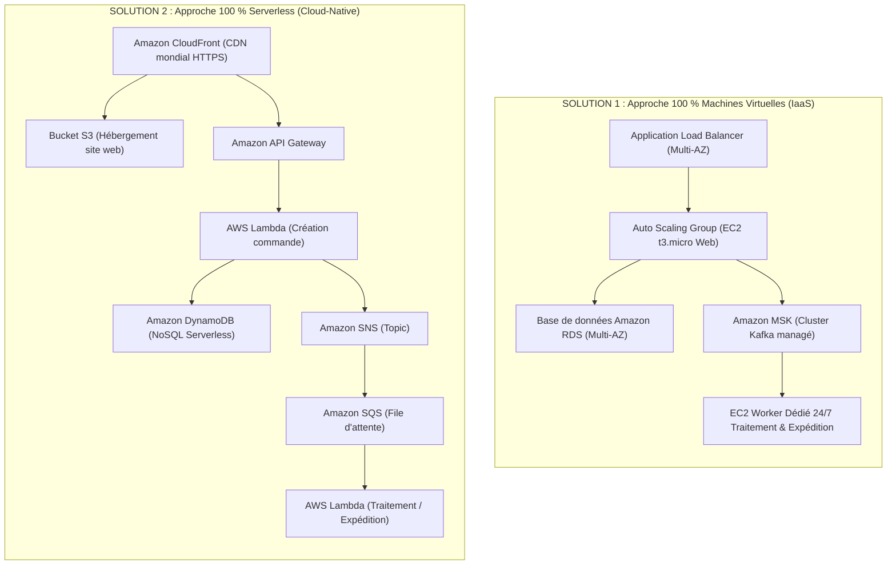

# Plan du Projet AWS — E-Commerce Haute Disponibilité & Batch Spot (FISA 2026)

**Étudiant :** Bastien | **Compte AWS :** `689505268069` | **Région :** `eu-west-3` (Paris)  
**Enseignant :** Pr. Raouf Boulkroune | **Outil IaC :** Terraform `v1.16.6`

---

## 1. Les 2 Solutions Théoriques Comparées (Attendu du Sujet)



---

## 2. L'Architecture Hybride Déployée en Terraform (Optimisée Free Tier & FinOps)

Pour répondre **à 100 % des exigences du sujet** (EC2 + Serverless + Haute Disponibilité Multi-AZ + Auto Scaling Front-End + Événementiel SNS + Maîtrise des coûts), voici l'architecture complète que nous implémentons :

```mermaid
flowchart TB
    Client["Client (Navigateur Web & Boîte Mail)"]

    subgraph IaaS_HA["1. Front-End Haute Disponibilité & Élasticité (IaaS Multi-AZ)"]
        ALB["Application Load Balancer (Public Multi-AZ)"]
        subgraph ASG["Auto Scaling Group Web (min=1, desired=2, max=4)"]
            EC2_A["VM EC2 Web Zone A (t3.micro)"]
            EC2_B["VM EC2 Web Zone B (t3.micro)"]
        end
        CW_Policy["CloudWatch Target Tracking (CPU > 60%)"]
        CW_Policy -.->|Scale-Out / Scale-In| ASG
        ALB --> EC2_A & EC2_B
    end

    subgraph Serverless_Core["2. Prise de Commande Synchrone (Serverless)"]
        Lambda["AWS Lambda: CreateOrder"]
        DDB[("Amazon DynamoDB: Catalogue & Commandes")]
    end

    subgraph Event_Messaging["3. File Tampon & Notifications SNS"]
        SNS_Order(("SNS: Confirmation Commande"))
        SNS_Ship(("SNS: Notification Expédition + N° Suivi"))
        SQS[["Amazon SQS: orders-batch-queue (Rétention 14j)"]]
    end

    subgraph Spot_Batch["4. Traitement Lourd Asynchrone (EC2 Spot Éphémère)"]
        Spot["EC2 Spot Worker (t3.micro Spot de Nuit / Batch)"]
        S3_PDF[("Amazon S3: Factures PDF & Rapports Audit")]
    end

    Client -->|1. Parcourt le catalogue & commande| ALB
    EC2_A & EC2_B -->|2. Appelle| Lambda
    Lambda -->|3. Enregistre (Statut: PENDING)| DDB
    Lambda -->|4a. Déclenche confirmation immédiate| SNS_Order
    SNS_Order -.->|Mail 1 : Commande reçue| Client
    Lambda -->|4b. Empile la commande| SQS

    SQS -->|5. Dépile la nuit (ou sur déclenchement)| Spot
    Spot -->|6a. Calcule taille colis (S/M/L/XL) + N° Suivi| DDB
    Spot -->|6b. Génère Facture PDF + Étiquette| S3_PDF
    Spot -->|6c. Statut = SHIPPED + N° Suivi + Lien PDF| SNS_Ship
    SNS_Ship -.->|Mail 2 : Colis Expédié + N° de Suivi !| Client
    Spot -.->|7. Extinction automatique (Scale-to-Zero)| Spot
```

---

## 3. Fonctionnement Détaillé du Système

### 3.1 Élasticité du Front-End (Auto Scaling Group EC2)
* **Application Load Balancer (ALB) :** Répartit le trafic web sur plusieurs sous-réseaux publics dans 2 zones de disponibilité distinctes (`eu-west-3a` et `eu-west-3b`).
* **Auto Scaling Group (ASG) :**
  * `min_size = 1` : Maintient toujours au moins 1 instance active en secours.
  * `desired_capacity = 2` : Deux instances tournent en temps normal pour une redondance Multi-AZ immédiate.
  * `max_size = 4` : Capacité d'absorption des pics de charge.
* **Target Tracking Scaling Policy :** Une métrique CloudWatch surveille la charge CPU moyenne de l'ASG. Si celle-ci dépasse 60 %, une instance supplémentaire est démarrée dynamiquement (*Scale-Out*). Lorsque la charge redescend, le groupe réduit sa taille automatiquement (*Scale-In*) pour préserver le quota Free Tier.

### 3.2 Les Tâches Exécutées par le Worker EC2 Spot
1. **Calcul de dimensionnement du colis (*Carrier Box Sizing*)** :
   * Chaque produit du catalogue possède des dimensions $(L \times l \times h\text{ en cm})$ et un poids $(\text{kg})$.
   * Le worker calcule le volume total (avec marge de calage de 15 %) et le poids total de la commande, puis sélectionne automatiquement le carton transporteur prédéfini optimal :
     * **Colis S (Petit)** : $20 \times 15 \times 10\text{ cm}$ ($\le 2\text{ kg}$) — Tarif transporteur : 4,90 € HT
     * **Colis M (Standard)** : $40 \times 30 \times 20\text{ cm}$ ($\le 10\text{ kg}$) — Tarif transporteur : 8,90 € HT
     * **Colis L (Volumineux)** : $60 \times 40 \times 40\text{ cm}$ ($\le 25\text{ kg}$) — Tarif transporteur : 14,90 € HT
     * **Colis XL (Palette)** : $100 \times 60 \times 60\text{ cm}$ ($> 25\text{ kg}$) — Tarif transporteur : 29,90 € HT
2. **Génération de la Facture PDF Officielle & Archivage S3** :
   * Le worker compile un fichier PDF (`fpdf2`) contenant le détail HT/TVA/TTC, le récapitulatif logistique (format de carton retenu, poids total, taux de remplissage du carton) et le **numéro de suivi transporteur** (`TRK-EUW3-...`).
   * Le PDF est stocké dans un bucket **Amazon S3** avec URL signée.
3. **Mise à jour de l'état de la commande & Notification SNS d'expédition** :
   * La commande passe à `SHIPPED` dans DynamoDB.
   * **Amazon SNS** envoie un e-mail au client avec son numéro de suivi transporteur et le lien de téléchargement de sa facture PDF.
4. **Auto-extinction (*Scale-to-Zero*)** : Une fois la file SQS vidée, l'instance Spot s'éteint pour garantir un coût minimal.
