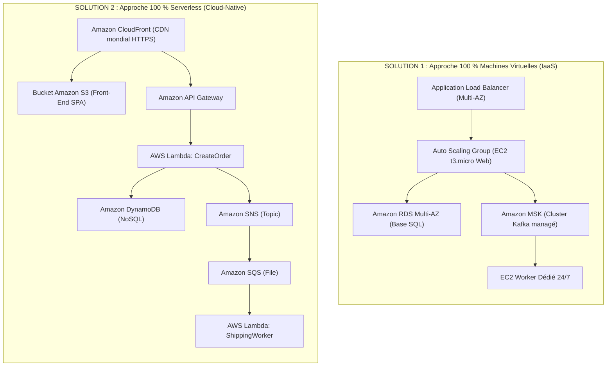

# Projet Cloud AWS — Boutique E-Commerce Haute Disponibilité (FISA 2026)

> **Projet académique :** FISA 2026 / Infrastructures cloud et virtualisation  
> **Enseignant :** Pr. Raouf Boulkroune  
> **Auteur :** Bastien (`Bastien7d3`) | **Compte AWS :** `689505268069` | **Région :** `eu-west-3` (Paris)  
> **Automatisation IaC :** Terraform

---

## 1. Sujet Officiel du Projet (Spécifications Client)

### Contexte & Spécifications
Réaliser une boutique en ligne où les clients peuvent consulter un catalogue, passer des commandes et recevoir des notifications de confirmation en temps réel.  
La plateforme doit être **évolutive, rentable et résiliente**. Elle sera construite à partir des services gérés par AWS dans le cadre de l'offre **Free Tier**.  
Le système doit gérer l'interface utilisateur, les commandes et le traitement des commandes.  
Le site doit être **hautement disponible**. Proposer **2 solutions différentes**, l'une basée sur des machines virtuelles et l'autre à base de services Serverless. Adapter votre solution pour **AWS Free Tier** en éliminant certaines fonctions pour maintenir le coût à zéro.

### Exigences fonctionnelles
* **Pour les clients :**
  * Parcourir un catalogue de produits via une interface Web.
  * Passer une commande pour un ou plusieurs produits.
  * Recevoir un message de confirmation après avoir passé leur commande.
* **Pour les systèmes internes de l'entreprise :**
  * Enregistrer toutes les commandes à des fins d'audit et de reporting.
  * Déclencher les opérations internes de traitement des commandes (emballage, simulation d'expédition avec numéro de suivi transporteur et facture PDF).

### Exigences architecturales
* Utiliser **AWS Serverless** et **Compute EC2**.
* Inclure des modèles événementiels (**SNS**) et aborder le streaming (**Kafka, MSK**).
* Utiliser **Terraform** pour l'automatisation intégrale de l'infrastructure.

---

## 2. Comparatif des 2 Solutions Demandées



### Analyse des Limites Free Tier (Pourquoi on adapte) :
* **Amazon MSK (Kafka) :** Aucun Free Tier existant (facturé au minimum ~70 $ à 200 $/mois dès la première minute).
* **Amazon RDS Multi-AZ :** Double la consommation d'heures ($744 \times 2 = 1488\text{ h/mois}$), dépassant le quota des 750h gratuites.
* **NAT Gateway :** Facturée ~35 $/mois par passerelle hors Free Tier.

---

## 3. Architecture Déployée en Terraform (Hybride Free Tier à 0,00 €)

Cette architecture réunit le meilleur des deux mondes pour satisfaire **100 % des exigences du professeur** sans générer le moindre centime de surcoût.

```mermaid
flowchart TB
    Client["Client Web (Navigateur / Mobile)"]

    subgraph Front_Tier["1. Entrée & Front-End Élastique (IaaS Multi-AZ)"]
        ALB["Application Load Balancer (Public Multi-AZ)"]
        subgraph ASG["Auto Scaling Group Web (min=1, desired=2, max=4)"]
            EC2_A["EC2 Web Zone A (t3.micro)"]
            EC2_B["EC2 Web Zone B (t3.micro)"]
        end
        CW_CPU["CloudWatch Alarm (Target Tracking CPU > 60%)"]
        CW_CPU -.->|Scale Out / In| ASG
        ALB --> EC2_A & EC2_B
    end

    subgraph Serverless_Order["2. Cœur de Commande Transactionnel (Serverless)"]
        Lambda["AWS Lambda: CreateOrder (Python 3.12)"]
        DDB_Catalog[("DynamoDB: Products")]
        DDB_Orders[("DynamoDB: Orders")]
    end

    subgraph Messaging_Buffer["3. Découplage, Notification Immédiate & Tampon"]
        SNS_Order(("Amazon SNS: OrderConfirmation"))
        SQS_Batch[["Amazon SQS: orders-batch-queue (Rétention 14j)"]]
    end

    subgraph Async_Spot_Batch["4. Traitement Batch Éphémère (EC2 Spot de Nuit / Batch)"]
        Spot["Instance EC2 Spot Worker (t3.micro Spot)"]
        S3_Bucket[("Amazon S3: Factures PDF & Rapports Audit")]
        SNS_Ship(("Amazon SNS: ShippingNotification"))
    end

    Client -->|1. Navigation & Panier| ALB
    EC2_A & EC2_B -->|2. Validation Commande| Lambda
    Lambda -->|3. Vérifie stock & décrémente| DDB_Catalog
    Lambda -->|4. Insère commande (Status: PENDING)| DDB_Orders
    Lambda -->|5a. Mail 1: Confirmation immédiate| SNS_Order
    SNS_Order -.->|Mail reçu| Client
    Lambda -->|5b. Empile pour le batch| SQS_Batch

    SQS_Batch -->|6. Dépile la nuit (ou déclenchement manuel)| Spot
    Spot -->|7a. Calcul taille carton (S, M, L, XL) & N° Suivi| DDB_Orders
    Spot -->|7b. Génère Facture PDF officielle| S3_Bucket
    Spot -->|7c. Mise à jour statut: SHIPPED| DDB_Orders
    Spot -->|8. Mail 2: N° Suivi transporteur + Lien PDF| SNS_Ship
    SNS_Ship -.->|Mail d'expédition| Client
```

---

## 4. Composants Détaillés de la Solution

### 4.1 Auto Scaling Front-End (Élasticité IaaS Web)
* **Application Load Balancer (ALB) :** Répartit les requêtes entrantes sur plusieurs zones de disponibilité (`eu-west-3a`, `eu-west-3b`).
* **Auto Scaling Group (ASG) :**
  * `min_size = 1` : Haute résilience de base.
  * `desired_capacity = 2` : Répartition Multi-AZ active pendant les heures ouvrées / démonstration.
  * `max_size = 4` : Capacité d'absorption automatique en cas de pic de trafic.
* **Politique d'élasticité (Target Tracking Policy) :** Déclenchement automatique d'instances supplémentaires si l'utilisation CPU moyenne dépasse 60 %, puis réduction automatique (*Scale-In*) dès que la charge retombe.

### 4.2 Cœur Serverless (Prise de Commande Synchrone)
* **AWS Lambda (`CreateOrder`) :** Code Python 3.12 gérant la validation transactionnelle du panier et la mise à jour atomique des stocks.
* **Amazon DynamoDB :** 
  * Table `Products` (catalogue, dimensions, poids, stocks).
  * Table `Orders` (commandes, statuts, historique).
  * Mode `PROVISIONED` fixé à **5 RCU / 5 WCU** (100 % *Always Free*).

### 4.3 Traitement Batch Asynchrone sur EC2 Spot (Calcul Colis & Facture PDF)
Au lieu de maintenir une VM coûteuse allumée 24h/24, une instance **EC2 Spot (`t3.micro`)** est lancée de façon éphémère (ex : la nuit pendant 2 heures ou sur déclenchement) :
1. **Dimensionnement automatique du colis transporteur :**
   * Calcule le volume total (avec marge de calage de 15 %) et le poids total de la commande.
   * Sélectionne automatiquement le format optimal parmi la grille transporteur prédéfinie :
     * **Colis S (Petit)** : $20\times 15\times 10\text{ cm}$ ($\le 2\text{ kg}$) — 4,90 € HT
     * **Colis M (Standard)** : $40\times 30\times 20\text{ cm}$ ($\le 10\text{ kg}$) — 8,90 € HT
     * **Colis L (Volumineux)** : $60\times 40\times 40\text{ cm}$ ($\le 25\text{ kg}$) — 14,90 € HT
     * **Colis XL (Palette)** : $100\times 60\times 60\text{ cm}$ ($> 25\text{ kg}$) — 29,90 € HT
2. **Génération de la Facture PDF officielle (`fpdf2`) :**
   * Tableau complet des lignes d'articles, TVA 20 %, total TTC.
   * Encadré logistique avec dimensions du carton, taux de remplissage volumétrique et numéro de suivi transporteur (`TRK-EUW3-2026-...`).
   * Téléversement sécurisé sur **Amazon S3** avec URL pré-signée.
3. **Mise à jour d'état & Notification d'expédition :**
   * La commande passe de `PENDING` $\rightarrow$ `PACKAGED` $\rightarrow$ `SHIPPED` dans DynamoDB.
   * **Amazon SNS** envoie un e-mail au client avec son numéro de suivi transporteur et le lien de téléchargement direct de la facture.
4. **Auto-extinction (*Scale-to-Zero*) :** Dès que la file SQS est vide, l'instance Spot s'éteint pour ne pas consommer de budget.

---

## 5. Analyse FinOps & Seuil de Rentabilité (Break-Even Point)

* **Coût de l'EC2 Spot en batch éphémère (2h / nuit = 60h / mois) :**
  * Calcul Spot `t3.micro` : $60\text{ h} \times 0,0031\text{ \$/h} = 0,186\text{ \$/mois}$.
  * Disque EBS `gp3` (8 Go) : $0,70\text{ \$/mois}$.
  * **Total mensuel : $\approx \mathbf{0,89\ \$/mois}$.**
* **Coût sur AWS Lambda (traitement lourd binaire 3s à 512 Mo de RAM) :** $\approx \mathbf{0,0000202\ \$ / commande}$.
* **Seuil de rentabilité :**
  $$\text{Seuil} = \frac{0,89\text{ \$}}{0,0000202\text{ \$}} \approx \mathbf{44\,000\text{ commandes / mois}}$$
  * *En dessous de 44 000 commandes/mois :* Lambda est couverte par les 400 000 Go-s de l'offre *Always Free* (0,00 €).
  * *Au-delà de 44 000 commandes/mois (ou si le traitement batch dépasse les 15 minutes max de timeout Lambda) :* L'EC2 Spot éphémère est largement plus économique (-75 % d'économies à 200 000 commandes).

---

## 6. Structure du Dépôt & Déploiement Terraform

```text
.
├── README.md                          # Documentation complète et architecture
├── 00_GUIDE_REUNION_PITCH_GROUPE.md   # Guide d'animation de réunion et répartition des tâches
├── 01_SUJET_OFFICIEL_ET_ALIGNEMENT.md # Sujet du professeur et conformité
├── 02_PLAN_ARCHITECTURE_COMPARATIF.md # Comparatif détaillé Solution 1 vs Solution 2
├── 03_DOSSIER_TECHNIQUE_ET_ANALYSE_FINOPS.md # Calculs FinOps complets
├── 05_PRESENTATION_VISUELLE_REUNION.html # Présentation interactive (zoomable & plein écran)
└── 04_POC_TERRAFORM_EC2_SPOT_PDF/     # Code Terraform du PoC validé sur AWS
    ├── main.tf                        # Configuration IaC (S3, DynamoDB, SQS, SNS, EC2 Spot)
    ├── worker.py.tftpl                # Worker Python (PDF + Colisage transporteur)
    ├── facture_CMD-2026-001.pdf       # Facture PDF générée lors du test réel sur AWS
    └── report_CMD-2026-001.json       # Rapport d'audit généré sur S3
```

### Déploiement et Destruction (Environnement Éphémère)
```powershell
# Déploiement complet
terraform init
terraform apply -auto-approve

# Destruction propre (Garantie 0,00 €)
terraform destroy -auto-approve
```
