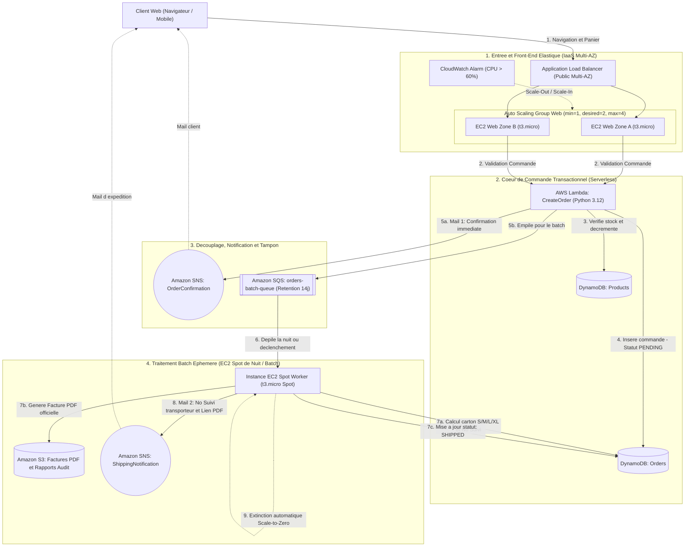

# Projet Cloud AWS — Boutique E-Commerce Haute Disponibilité (FISA 2026)

> **Projet académique :** FISA 2026 / Infrastructures cloud et virtualisation  
> **Enseignant :** Pr. Raouf Boulkroune  
> **Auteur :** Bastien (`Bastien7d3`) | **Compte AWS :** `689505268069` | **Région :** `eu-west-3` (Paris)  
> **Automatisation IaC :** Terraform

---

## 1. Sujet Officiel du Projet (Spécifications Client)

### Contexte & Spécifications
Réaliser une boutique en ligne où les clients peuvent consulter un catalogue, passer des commandes et recevoir des notifications de confirmation en temps réel.  
La plateforme doit être **évolutive, rentable et résiliente**. Elle sera construite à partir des services gérés par AWS dans le cadre de l'offre **Free Tier**.  
Le système doit gérer l'interface utilisateur, les commandes et le traitement des commandes.  
Le site doit être **hautement disponible**. Adapter votre solution pour **AWS Free Tier** en éliminant certaines fonctions pour maintenir le coût à zéro.

### Exigences fonctionnelles
* **Pour les clients :**
  * Parcourir un catalogue de produits via une interface Web.
  * Passer une commande pour un ou plusieurs produits.
  * Recevoir un message de confirmation après avoir passé leur commande.
* **Pour les systèmes internes de l'entreprise :**
  * Enregistrer toutes les commandes à des fins d'audit et de reporting.
  * Déclencher les opérations internes de traitement des commandes (emballage, simulation d'expédition avec numéro de suivi transporteur et facture PDF).

### Exigences architecturales
* Utiliser **AWS Serverless** et **Compute EC2**.
* Inclure des modèles événementiels (**SNS**) et aborder le streaming (**Kafka, MSK**).
* Utiliser **Terraform** pour l'automatisation intégrale de l'infrastructure.

---

## 2. Architecture Retenue (Hybride Free Tier à 0,00 €)

L'architecture réunit l'élasticité IaaS (Auto Scaling Group EC2 pour le site web), la réactivité Serverless (AWS Lambda + DynamoDB pour la prise de commande synchrone) et l'économie du modèle Batch asynchrone (Worker EC2 Spot éphémère).



---

## 3. Détail des Composants Techniques

### 3.1 Élasticité Front-End (Auto Scaling Group EC2)
* **Application Load Balancer (ALB) :** Répartit les requêtes HTTP entrantes sur 2 sous-réseaux publics dans des zones de disponibilité distinctes (`eu-west-3a`, `eu-west-3b`).
* **Auto Scaling Group (ASG) :**
  * `min_size = 1` : Haute résilience de base.
  * `desired_capacity = 2` : Répartition Multi-AZ active pendant les heures ouvrées / démonstration.
  * `max_size = 4` : Capacité d'absorption automatique en cas de pic de trafic.
* **Target Tracking Policy :** Déclenchement automatique d'instances supplémentaires si l'utilisation CPU moyenne dépasse 60 %, puis réduction automatique (*Scale-In*) dès que la charge retombe.

### 3.2 Cœur Serverless (Prise de Commande Synchrone)
* **AWS Lambda (`CreateOrder`) :** Code Python 3.12 gérant la validation transactionnelle du panier et la mise à jour atomique des stocks.
* **Amazon DynamoDB :** 
  * Table `Products` (catalogue, dimensions, poids, stocks).
  * Table `Orders` (commandes, statuts, historique).
  * Mode `PROVISIONED` fixé à **5 RCU / 5 WCU** (100 % *Always Free*).

### 3.3 Traitement Batch Asynchrone sur EC2 Spot (Calcul Colis & Facture PDF)
Au lieu de maintenir une VM coûteuse allumée 24h/24, une instance **EC2 Spot (`t3.micro`)** est lancée de façon éphémère (la nuit pendant 2 heures ou sur déclenchement) :
1. **Dimensionnement automatique du colis transporteur :**
   * Calcule le volume total (avec marge de calage de 15 %) et le poids total de la commande.
   * Sélectionne automatiquement le format optimal parmi la grille transporteur prédéfinie :
     * **Colis S (Petit)** : 20 x 15 x 10 cm (max 2 kg) — 4,90 € HT
     * **Colis M (Standard)** : 40 x 30 x 20 cm (max 10 kg) — 8,90 € HT
     * **Colis L (Volumineux)** : 60 x 40 x 40 cm (max 25 kg) — 14,90 € HT
     * **Colis XL (Palette)** : 100 x 60 x 60 cm (> 25 kg) — 29,90 € HT
2. **Génération de la Facture PDF officielle (`fpdf2`) :**
   * Tableau complet des lignes d'articles, TVA 20 %, total TTC.
   * Encadré logistique avec dimensions du carton, taux de remplissage volumétrique et numéro de suivi transporteur (`TRK-EUW3-2026-...`).
   * Téléversement sécurisé sur **Amazon S3** avec URL pré-signée.
3. **Mise à jour d'état & Notification d'expédition :**
   * La commande passe de `PENDING` à `PACKAGED` puis `SHIPPED` dans DynamoDB.
   * **Amazon SNS** envoie un e-mail au client avec son numéro de suivi transporteur et le lien de téléchargement direct de la facture.
4. **Auto-extinction (*Scale-to-Zero*) :** Dès que la file SQS est vide, l'instance Spot s'éteint pour ne pas consommer de budget.

---

## 4. Analyse FinOps & Seuil de Rentabilité (Break-Even Point)

### Comparatif des coûts (Région eu-west-3 Paris)

* **Coût de l'EC2 Spot en batch éphémère (2h / nuit = 60h / mois) :**
  * Calcul Spot `t3.micro` : 60 h x 0,0031 $/h = **0,186 $/mois**
  * Disque EBS `gp3` (8 Go) : **0,70 $/mois**
  * **Total mensuel fixe du worker : environ 0,89 $/mois**

* **Coût sur AWS Lambda (génération PDF 3s à 512 Mo de RAM) :**
  * Environ **0,0000202 $ par commande**

### Seuil de rentabilité mathématique
* `Seuil = 0,89 $ / 0,0000202 $` = **environ 44 000 commandes / mois** (~1 450 commandes / jour)
* **En dessous de 44 000 commandes/mois :** Le Serverless (Lambda) est le plus économique, et les 266 000 premières exécutions sont couvertes à **0,00 €** par l'offre *Always Free* (400 000 Go-secondes).
* **Au-delà de 44 000 commandes/mois :** L'EC2 Spot éphémère est nettement plus avantageux (-75 % à 200 000 commandes). De plus, elle s'affranchit de la limite stricte des **15 minutes d'exécution maximum** imposée par AWS Lambda pour les très gros traitements par lots.

---

## 5. Structure du Dépôt & Déploiement

```text
.
├── README.md                          # Documentation complète et architecture
├── ProjetAWS_FISA2026_RBE.pdf         # Sujet officiel du projet
└── poc-spot-pdf/                      # PoC Terraform validé sur AWS
    ├── main.tf                        # Configuration IaC (S3, DynamoDB, SQS, SNS, EC2 Spot)
    ├── worker.py.tftpl                # Worker Python (PDF + Colisage transporteur)
    ├── facture_CMD-2026-001.pdf       # Facture PDF générée lors du test réel sur AWS
    └── report_CMD-2026-001.json       # Rapport d'audit généré sur S3
```

### Déploiement et Destruction du PoC
```powershell
cd poc-spot-pdf

# Déploiement complet sur AWS
terraform init
terraform apply -auto-approve

# Destruction propre (Garantie 0,00 €)
terraform destroy -auto-approve
```
